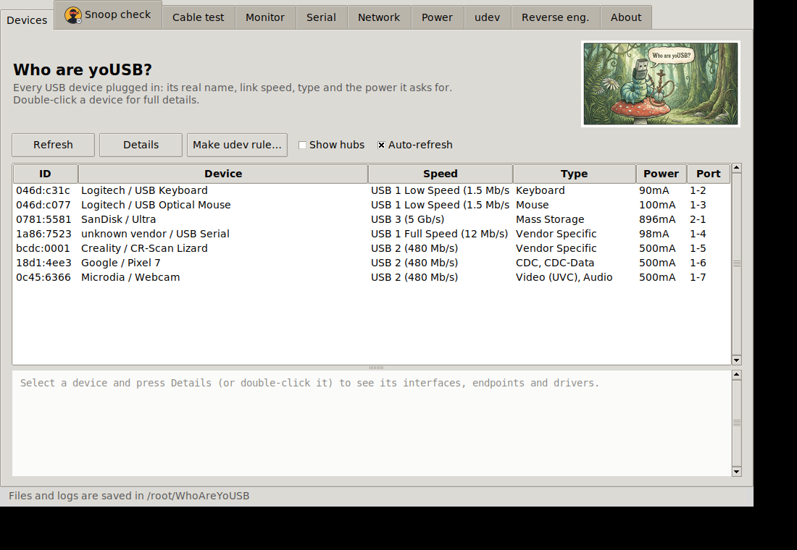
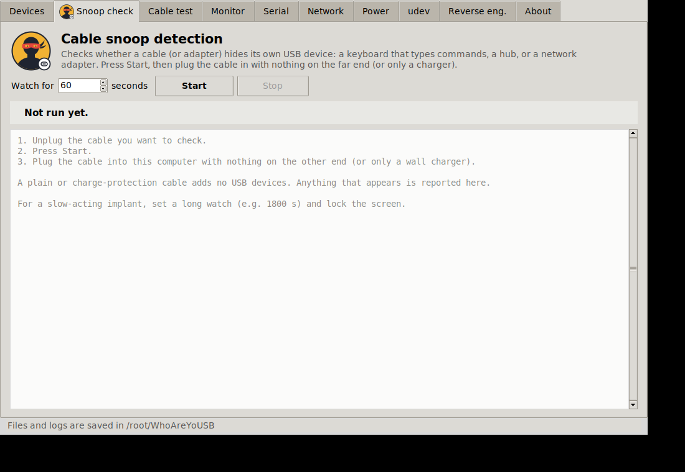
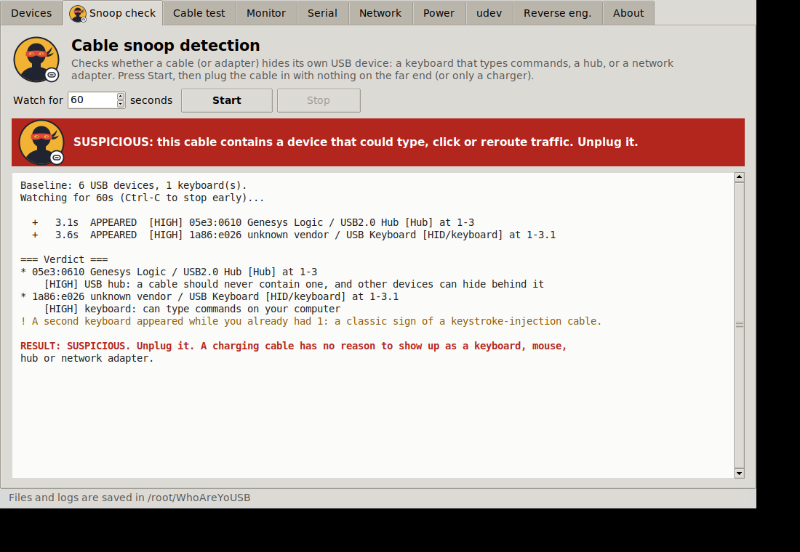
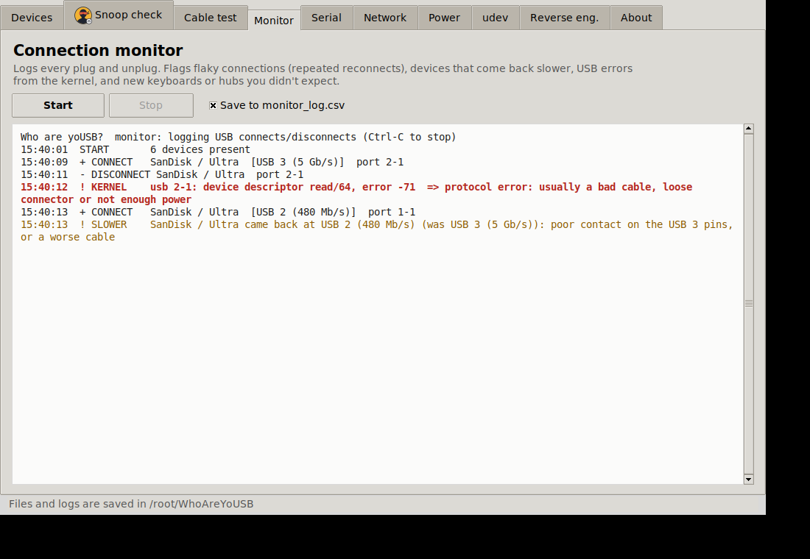
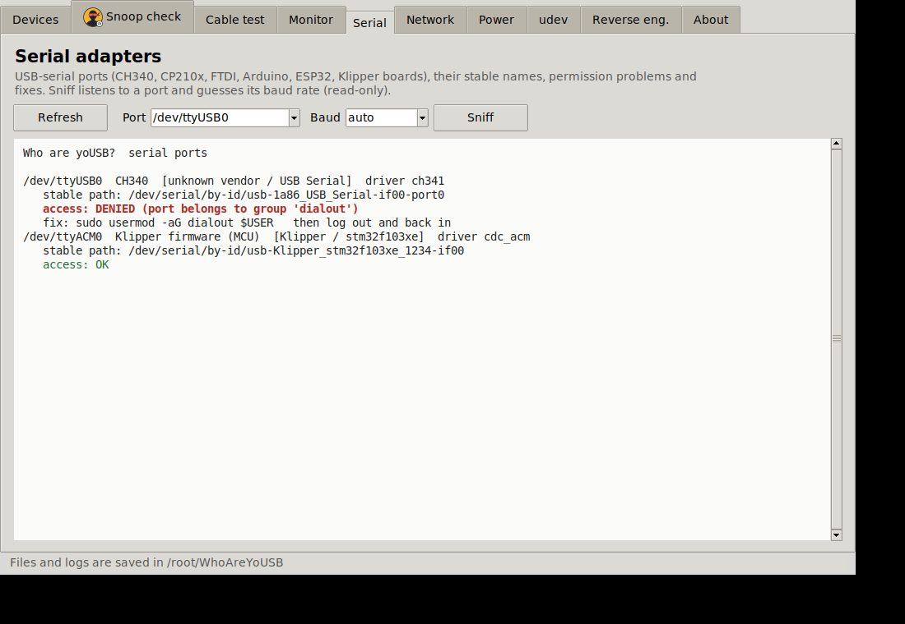
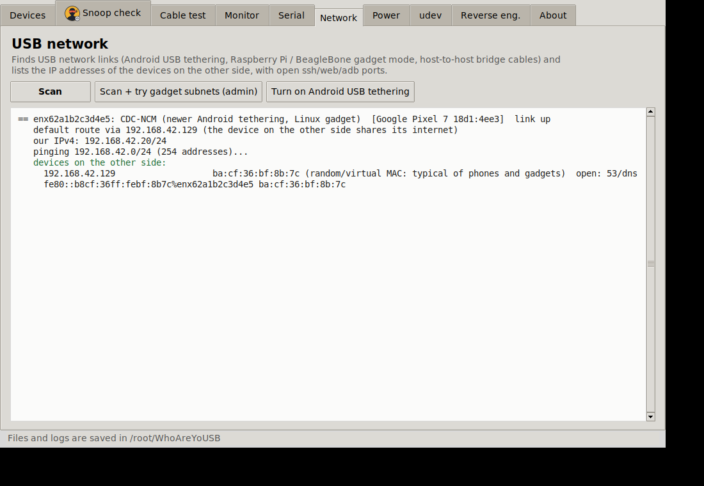
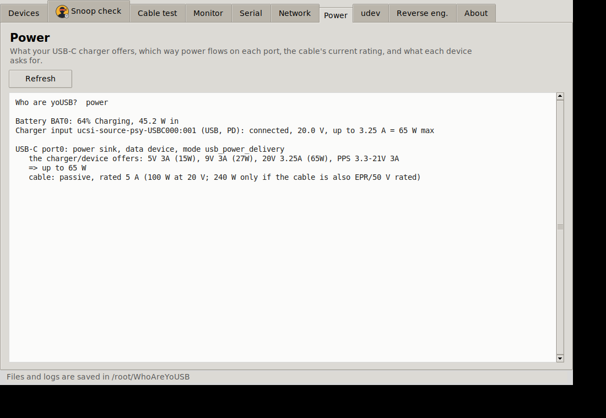
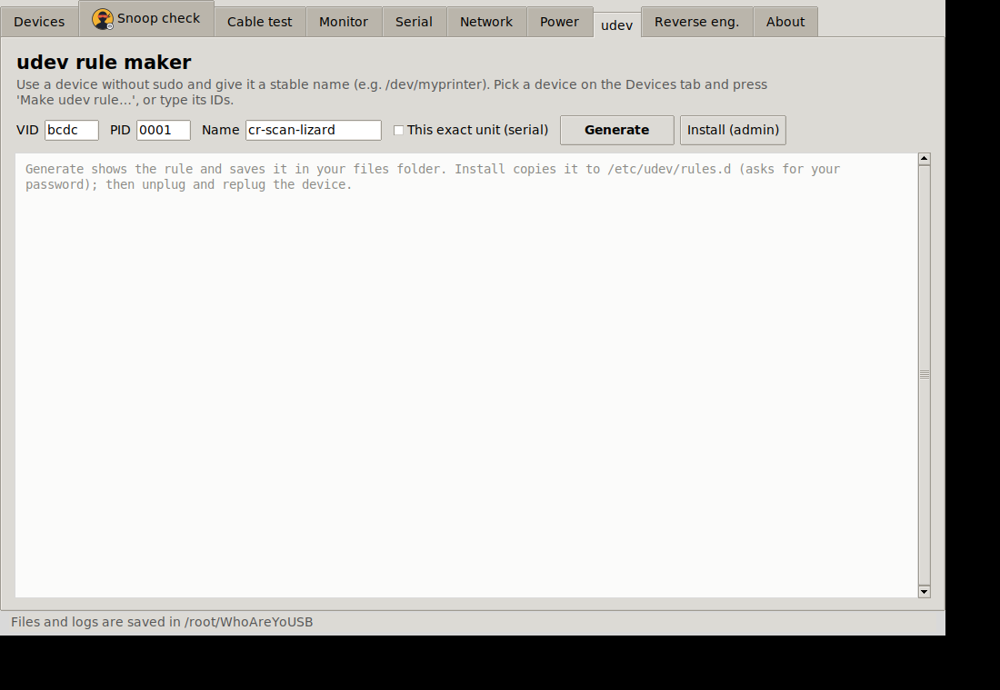
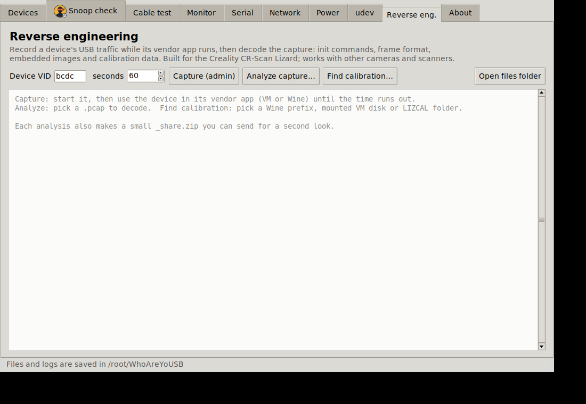

# Who are yoUSB?

<p align="center"></p>

> # ⚠️ WORK IN PROGRESS: MANY FEATURES MAY BE BROKEN
> **This is an early, unfinished version (v0.1.0-wip).** It has only been tested against *simulated* USB data, fake
> sysfs trees and a virtual display, **not** against a wide range of real devices, cables or computers.
> Expect bugs, wrong readings, missing features and rough edges. **Do not rely on it for security decisions**
> (for example "this cable is safe") or for anything important. Bug reports are very welcome; see
> [CONTRIBUTING.md](CONTRIBUTING.md).

> **Licence:** free for **non-commercial** use (personal, hobby, educational, charity). Provided **as is, with no warranty
> and no liability**. See [LICENSE.md](LICENSE.md) (PolyForm Noncommercial 1.0.0). This is *source-available*, not
> OSI "open source".

**Source-available · Non-commercial · v0.1.0-wip**

A multipurpose USB toolkit for **Linux**: one Python file, no required dependencies, with a point-and-click window or
a command line.

| | |
|---|---|
| **Identify** | Every USB device with its real name, speed, class and driver; full descriptor reports; USB-C charger/cable power info |
| **Security** | *Cable snoop detection*: does a cable (or gadget) secretly contain a keyboard, hub or network adapter? |
| **Cables** | Charge-only, USB 2 or USB 3? Live plug/unplug log that flags flaky connections and USB errors |
| **Setup** | USB-serial helper (port names, permissions, brltty/ModemManager conflicts), udev rule maker |
| **Networking** | Find USB network links (phone tethering, Pi gadget mode) and list the IP addresses on the other side |
| **Reverse engineering** | Capture and decode USB traffic (built for the Creality CR-Scan Lizard; works on any USB camera/scanner) |



## Install and run

Needs Python 3 (developed on 3.12; older 3.x untested). The window needs tkinter; the command line does not.

| Distro | One-off setup |
|---|---|
| Ubuntu / Mint / Debian | `sudo apt install python3-tk` |
| Fedora | `sudo dnf install python3-tkinter` |
| Arch | `sudo pacman -S tk` |

```bash
git clone https://github.com/The-Dorkknight/who-are-yousb.git
cd who-are-yousb
python3 whoareyousb.py          # opens the window on a desktop, otherwise lists devices
python3 whoareyousb.py list     # command line
python3 whoareyousb.py --help   # every command
```

Most things work without root. These need `sudo` (or the window will ask via `pkexec`): `capture`, `udev --install`,
`usb-net --assign`, and reading the kernel log in `monitor`.

**It only changes your system when you ask**: `usb-net --assign/--android` (temporary IP addresses / phone
tethering) and `udev --install` (adds one rule file). Everything else only reads. Details in [HOW_IT_WORKS.md](HOW_IT_WORKS.md).

## The tabs

| Tab | What it does | Screenshot |
|---|---|---|
| **Devices** | Lists everything plugged in with friendly names and speed; click one for details |  |
| **Cable snoop** | Plug the suspect cable in and watch: anything beyond the one device you expected is flagged. The masked-bandit icon **only** appears when something looks malicious |   |
| **Cable test** | Plug a known USB 3 drive through a cable to see whether it carries USB 3, only USB 2, or is charge-only | |
| **Monitor** | Live connect/disconnect log; warns about reconnect loops, speed drops and kernel USB errors |  |
| **Serial** | Finds USB-serial adapters, stable `/dev/serial/by-id` names, `dialout` group fixes, brltty conflicts |  |
| **Network** | Finds phone-tethering / gadget-mode links and lists devices on the other side |  |
| **Power** | USB-C charger offers, cable rating, what each device draws |  |
| **udev** | Generates a rule for no-sudo access and a stable name |  |
| **Reverse eng.** | Capture/analyse vendor-app traffic; find saved calibration files |  |

### Cable snoop detection: what it can and can't tell you
Unbranded cables with a chip inside are usually just charging-protection or e-marker chips. A hostile cable
(O.MG-style) pretends to be a keyboard or network adapter. The tool flags devices that appear *in addition to* what you
plugged in, unexpected HID/network/storage interfaces, and odd descriptors. **A clean result is not proof of safety**: a cable
that only activates later, or only on certain hosts, will not show up. For real protection use
[`usbguard`](https://usbguard.github.io/) so new keyboards need your approval.

## Reverse engineering a scanner (the original goal)
1. Plug in the scanner and run `python3 whoareyousb.py list --lizard`.
2. In a Windows VM with USB passthrough, run the vendor app while `sudo python3 whoareyousb.py capture` records.
3. `python3 whoareyousb.py analyze <capture>` decodes control transfers, firmware download, frame layout, embedded images and
   calibration data, and writes a `*_share.zip` you can send to others.
4. On the Windows side, `find_lizard_calib.ps1` (no install needed) collects saved calibration files into `LIZCAL\`.

## Troubleshooting

| Problem | Fix |
|---|---|
| `No module named tkinter` / window won't open | Install tkinter (table above). The command line still works without it |
| Empty device list | Run on a real Linux desktop, not a container; check `ls /sys/bus/usb/devices` |
| `Permission denied` on capture/udev/usb-net | Run with `sudo`, or accept the admin prompt |
| Power/USB-C tab is empty | Your laptop doesn't expose `/sys/class/typec` or `power_supply` data |
| Serial port won't open | Add yourself to `dialout` (Serial tab shows the command), remove `brltty` if it grabs CH340 |
| Wrong or scary-looking result | It's a work in progress: please open a bug report |

## Known limitations (please read)
- **Everything above was developed without real hardware in the loop.** Real Lizard, real cables, real phones: untested.
- USB networking: IPv6 discovery is untested; the IPv4 sweep was tested only in network namespaces.
- USB-C / PD / e-marker info depends on your laptop exposing `/sys/class/typec` and `/sys/class/power_supply`; many don't.
- Cable snoop and cable test are heuristics and can give false alarms or miss things.
- The GUI was only checked on one virtual display; other themes/scaling may look off.
- Linux only. Wayland/X11 both expected to work; macOS and Windows are not supported (the PowerShell helper is the exception).

## More documentation
- [HOW_IT_WORKS.md](HOW_IT_WORKS.md): what it reads, what it may change, and how each feature works
- [CHANGELOG.md](CHANGELOG.md), [CONTRIBUTING.md](CONTRIBUTING.md), [SECURITY.md](SECURITY.md), [THIRD_PARTY.md](THIRD_PARTY.md)

---
Copyright Matthew Armstrong ([The-Dorkknight](https://github.com/The-Dorkknight)). Not affiliated with Creality, 3DMakerPro/JimuMeta, USB-IF or anyone else named here.
